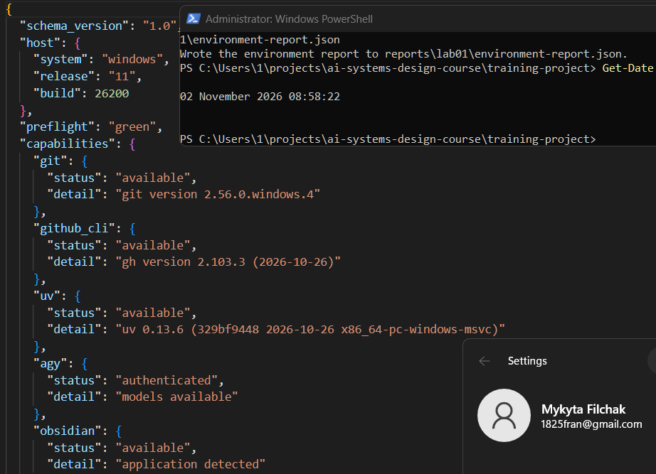
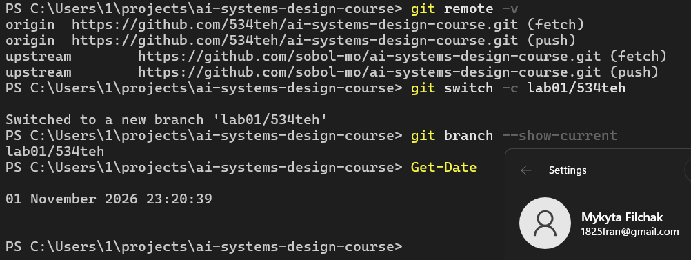
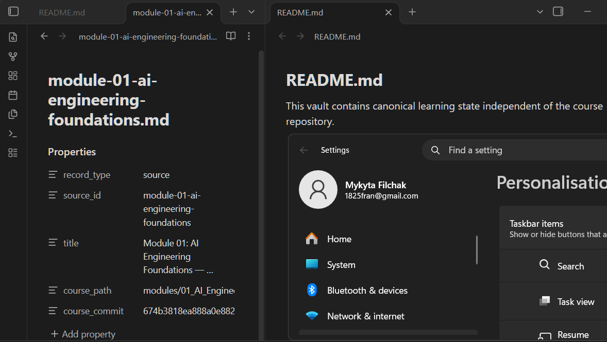
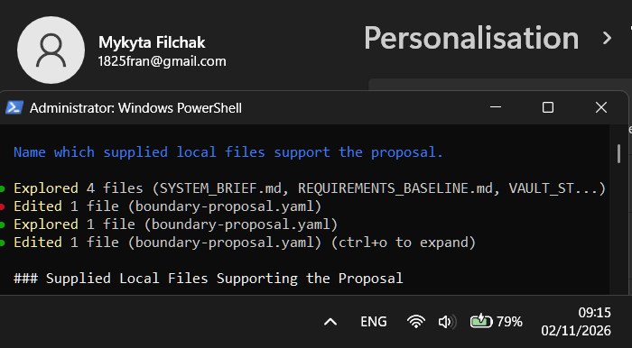
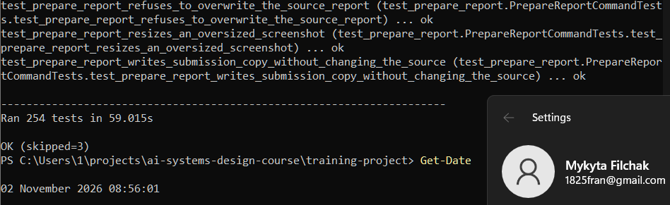
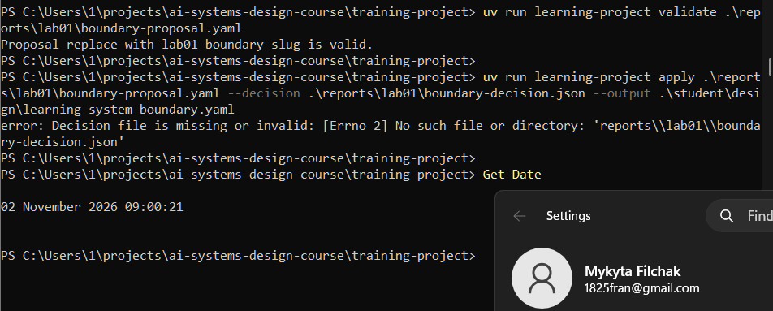
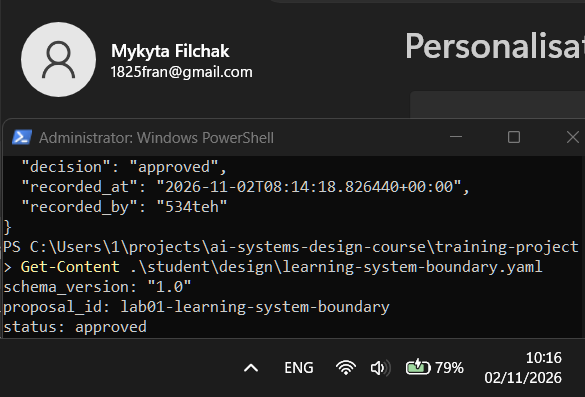

# Лабораторна робота 01

## Ідентифікація подання

- URL форку: https://github.com/534teh/ai-systems-design-course
- Назва гілки: lab01/534teh
- Повний хеш коміту: ebcc8fc5606210788c045afa7a76de5a3c2d2554

## Мета роботи

Створення та верифікація відтворюваної інфраструктури робочої станції та проєкту для наданої наскрізної навчальної системи знань, а також установлення контрольованої межі системи із суворим розмежуванням повноважень між генеративним пропонувачем (ШІ), детермінованим робочим процесом перевірки та студентом як єдиним суб'єктом затвердження рішень до модифікації канонічного стану.

## Середовище

Робочу станцію розгорнуто на базі операційної системи Windows 11 (збірка 26200). Налаштування виконано за допомогою маніфесту `fixtures/windows/lab01-workstation-windows11.dsc.yaml` через WinGet Configuration. Перше застосування конфігурації узгодило стан потрібних засобів: Git (2.56.0.4), GitHub CLI (2.103.3), `uv` (0.13.6) та Obsidian (1.9.12). Повторне застосування маніфесту підтвердило збіжність (ідempotентність): усі компоненти визначено як такі, що вже задовольняють оголошений стан, без перевстановлення чи зниження версій, що зафіксовано в журналі `provision.log`.

Діагностика робочої станції за допомогою утиліти `learning-project doctor` підтвердила статус `green` для всіх чотирьох обов'язкових можливостей інструментарію, а також успішну автентифікацію Antigravity CLI (`agy`), результати якої зафіксовано в `reports/lab01/environment-report.json`. Жодних блокувальних помилок під час розгортання та перевірки середовища не виявлено.

Рисунок — `02-workstation-capabilities.png`

## Власність репозиторію

Репозиторій налаштовано відповідно до вимог курсу з чітким розмежуванням прав власності:
- `origin` вказує на особистий форк на платформі GitHub (`https://github.com/534teh/ai-systems-design-course.git`) з повними правами на читання та запис;
- `upstream` вказує на канонічний публічний репозиторій викладача (`https://github.com/sobol-mo/ai-systems-design-course.git`) виключно для отримання синхронізаційних оновлень;
- виконання завдань ведеться в особистій гілці `lab01/534teh`, створеній від актуального стану гілки `main`.

Артефакти проєкту, що створюються під час виконання лабораторної роботи, ізольовано в персональних каталогах студента (`reports/lab01/` та `student/design/`), що унеможливлює модифікацію спільних шляхів курсу.

Рисунок — `01-git-remotes.png`

## Зовнішнє сховище Markdown-файлів

Канонічне сховище Markdown-нотаток під керуванням Obsidian створено з розташуванням `external to repository` (поза межами локального Git-репозиторію курсу). У корені сховища створено файл `README.md`, який фіксує статус сховища як канонічного середовища накопичення знань під безпосереднім контролем студента, незалежного від Git-структури проєкту.

У каталозі сховища `sources/` зареєстровано перший файл джерела `sources/module-01-ai-engineering-foundations.md` із повною YAML-передмовою, що вказує на теоретичний матеріал курсу за точним 40-значним хешем коміту Git (`674b3818ea888a0e882ab3c986847fbf767899cd`). Додаткові каталоги понять та зв'язків не створювалися, що відповідає межам Лабораторної роботи 01.

Сховище не захищено від ризику втрати робочої станції, бо воно не синхронізується з хмарою. Копія сховища щодня зберігається на зовнішній накопичував за допомогою File History, що запобігає втраті даних у разі виходу з ладу вбудованого сховища.

Рисунок — `05-external-vault.png`

## Шлях пропонувача

Для підготовки початкової межі системи використано типовий шлях агента — Antigravity CLI (`agy`), автентифікований через обліковий запис Google. Сеанс проведено 2026-11-02. Пропонувач опрацював специфікації `SYSTEM_BRIEF.md`, `REQUIREMENTS_BASELINE.md` та `VAULT_STRUCTURE.md`, надав аналітичний опис ключових аспектів архітектури та замінив змістовні заповнювачі у файлі `reports/lab01/boundary-proposal.yaml`.

Роль пропонувача було строго обмежено: ШІ-агент виконував редагування виключно файлу-кандидата `boundary-proposal.yaml` і не мав прав на виконання команд `decide`, `apply` чи редагування прийнятого контракту `student/design/learning-system-boundary.yaml`. Усі привілейовані дії виконувалися студентом безпосередньо в терміналі.

Рисунок — `04-proposer-session.png`

## Семантичний розгляд

Записати відповідь і висновок для кожного з дев’яти запитань кроку 8 **до** запуску `decide`.

1. **Чи зберігає пропозиція надану навчальну систему знань, використовуючи `personal_domain` лише для можливого пізнішого обмеженого розширення?**
   - **Відповідь:** Так. Пропозиція фіксує ідентичність системи згідно з `SYS-001` як локальну систему з підтримкою ШІ для вивчення технічних концептів із базовим шляхом із модулів курсу. Поле `personal_domain` описує лише можливу нечутливу професійну область («Розподілені системи та архітектура програмного забезпечення») без підміни системного ядра чи створення предметних ієрархій каталогів (`SYS-004`, `L01-015`).
   - **Висновок:** Вимоги щодо ідентичності та меж особистого розширення повністю збережено.

2. **Чи описує запланований навчальний результат спостережувану спроможність студента, а не застосування ШІ?**
   - **Відповідь:** Так. У полі `intended_learning_outcome` зафіксовано спроможність студента простежувати концепти до перевірених джерел, узгоджувати кандидати з прийнятими зв’язками, виявляти прогалини та отримувати підтверджені доказами відповіді (`FUN-001`–`FUN-014`), а не просто факт генерації тексту моделлю.
   - **Висновок:** Фокус залишається на навчальній спроможності студента й перевірності знань.

3. **Чи запобігають не-цілі розростанню в повну виробничу систему або процес ухвалення рішень із високими наслідками?**
   - **Відповідь:** Так. Поле `non_goals` прямо виключає автономну модифікацію сховища без рішення студента (`SYS-003`, `GOV-001`), перевизначення базових вимог курсу (`SYS-007`), передчасне проєктування архітектури в Лаб 01 (`SYS-008`), навчання базових моделей з нуля (`SYS-009`) та прийняття медичних, фінансових, юридичних або критичних для безпеки рішень (`SYS-010`).
   - **Висновок:** Межі системи надійно захищені від неконтрольованого розширення та високих ризиків.

4. **Чи обмежує розподіл обов'язків ШІ пропонуванням, покладає структурний контроль на детермінований робочий процес і зберігає повноваження затвердження за студентом? Як це розмежовано на ручному запасному шляху?**
   - **Відповідь:** Так. Секція `governance` чітко розмежовує ролі: ШІ інтерпретує джерела та генерує кандидати без права затвердження чи модифікації канонічного стану (`GOV-001`, `GOV-002`); детермінований процес перевіряє схеми й прив'язує рішення до SHA-256 дайджесту (`GOV-003`, `GOV-007`); остаточне семантичне схвалення/відхилення належить виключно студенту (`SYS-003`, `GOV-006`). У разі ручного запасного шляху звіт фіксує авторство студента для конкретного файлу-кандидата, не спотворюючи цільовий розподіл обов'язків у системі.
   - **Висновок:** Розподіл повноважень повністю відповідає контракту поділу допомоги та авторитету.

5. **Чи може умова корисності бути перевірена на збережених свідченнях джерел?**
   - **Відповідь:** Так. Умова корисності (`usefulness_condition`) стверджує, що кожен прийнятий концепт, зв'язок і відповідь повинні спиратися на версійно-визначене джерело (`STA-002`), кандидат-пропозицію, підписане дайджестом рішення студента та відтворювані похідні представлення (`QUA-003`, `STA-007`). Усі ці елементи мають явні артефакти аудиту.
   - **Висновок:** Умова корисності є спостережуваною та верифікованою.

6. **Чи описує ризик правдоподібну відмову повного робочого процесу?**
   - **Відповідь:** Так. У `material_risk` описано «семантичне штампування» (rubber-stamping) — ситуацію, коли проходження структурної перевірки або зовнішня зв'язність тексту ШІ хибно сприймається як доказ семантичної істинності (`GOV-005`), що веде до внесення помилок у канонічне сховище.
   - **Висновок:** Ризик реалістичний і відображає основну проблему людино-машинної взаємодії.

7. **Чи є базова лінія без ШІ дійсно простішою та здатною забезпечити частину результату?**
   - **Відповідь:** Так. Ручне створення Markdown-файлів у структурі `sources/`, `concepts/` та `questions/` у поєднанні з Git-хешами та детермінованими скриптами валідації (`non_ai_baseline`) є простішим, не залежить від сторонніх API й забезпечує збереження та структурування знань без автоматизованого аналізу.
   - **Висновок:** Базова лінія є дієвою точкою порівняння.

8. **Чи охоплюють обов'язкові свідчення як детерміновану поведінку, так і семантичний розгляд чи обґрунтування джерелами?**
   - **Відповідь:** Так. `required_evidence` охоплює детерміновану валідацію схем і перевірку SHA-256 дайджесту в `boundary-decision.json` перед `apply` (`L01-011`, `L01-013`), а також семантичний розгляд студентом у `REPORT.md` і реєстрацію джерела Модуля 01 у сховищі з прив'язкою до 40-значного коміту Git (`FUN-001`, `L01-008`, `L01-012`).
   - **Висновок:** Забезпечено повне покриття структурних і змістовних доказів.

9. **Чи ідентифікує невизначеність те, що ще не встановлено?**
   - **Відповідь:** Так. `uncertainty` явно вказує на нерозкриті на етапі Лаб 01 вхідні дані, які постачаються пізніше: референтну архітектуру (`SYS-006`), замкнений словник типізованих зв'язків, числові критерії оцінки пошуку та відповідей, а також технічну автентифікацію оператора команди (`REQUIREMENTS_BASELINE.md#L164-L172`).
   - **Висновок:** Невизначеність чесно зафіксована відповідно до базових вимог.

## Розподіл повноважень

У системі проєктування з використанням штучного інтелекту роль генеративної моделі фундаментально обмежена функцією пропонування (`ai_role`), тоді як повноваження остаточного затвердження (`human_role`) закріплені виключно за людиною. ШІ-моделі є стохастичними генераторами тексту, які оптимізують правдоподібність послідовності токенів, але не володіють фактологічною відповідальністю, розумінням істинності чи здатністю нести наслідки за некоректні проєктні рішення. Надання ШІ автономного права вносити зміни до канонічного стану створило б критичний ризик «тихих галюцинацій» та деградації бази знань.

Структурний детермінований робочий процес (`deterministic_role`) забезпечує технічний бар'єр: перевіряє синтаксичну валідність схем і пов'язує рішення оператора з точним SHA-256 криптографічним дайджестом вмісту пропозиції в `boundary-decision.json`. Студент здійснює змістовну експертизу та несе повну відповідальність за прийняття контракту. Застосування змін (`apply`) можливе лише за умови одночасного проходження детермінованих перевірок і наявності зафіксованого позитивного рішення людини.

## Корисність і базова лінія без ШІ

Штучний інтелект становить практичну корисність на етапі аналітичної обробки неструктурованих текстів: він прискорює виділення ключових понять, формування проєктних формулювань, визначення потенційних суперечностей і структурування пропозицій за встановленим шаблоном. Це зменшує час первинного опрацювання матеріалу та мінімізує механічну рутину.

Простіша базова лінія без ШІ (`non_ai_baseline`) полягає у повністю ручному опрацюванні першоджерел, створенні Markdown-файлів нотаток у текстовому редакторі за фіксованою структурою каталогів, ручному перехресному зв'язуванні концептів та верифікації за допомогою Git-хешів і детермінованих скриптів валідації. Базова лінія не залежить від сторонніх API, мережевого підключення чи квот доступу і повністю унеможливлює генеративні галюцинації. Проте вона вимагає суттєво більших трудовитрат. Застосування ШІ виправдане лише тоді, коли генеративна швидкість підготовки кандидатів підтримується жорсткими детермінованими фільтрами й обов'язковим експертним контролем людини.

## Особиста предметна сфера як пізніше розширення

Визначена предметна область `personal_domain` («Розподілені системи та архітектура програмного забезпечення») слугує виключно обмеженим контекстом для подальшого розширення системи в наступних модулях курсу (зокрема під час побудови типізованих графів знань і механізмів вибірки). Зазначений вибір не підміняє та не змінює базової сутності навчальної системи знань, регламентованої вимогами `SYS-001` та `SYS-004`.

Запланований результат навчання (`intended_learning_outcome`) виражено через спостережувані інженерні спроможності: трасування технічних концепцій до зареєстрованих першоджерел, верифікацію кандидатів на поняття з уже зафіксованими зв'язками, фіксацію відкритих прогалин у знаннях у вигляді структурованих питань та надання підтверджених відповідними джерелами відповідей на основі канонічного стану Markdown-сховища. Основний акцент зміщено з факту взаємодії з моделлю штучного інтелекту чи специфіки конкретної дисципліни на відтворюваність процесу, системні межі та збереження авторського контролю над канонічними даними.

## Проєктний компроміс

Ключовим проєктним компромісом у роботі є баланс між швидкістю/автоматизацією наповнення сховища та ризиком засмічення канонічного стану. Повна автономія ШІ дозволила б генерувати та затверджувати артефакти значно швидше, проте суттєво підвищила б імовірність потрапляння недостовірних або спотворених фактів до бази знань.

Свідоме рішення обмежити ШІ роллю пропонувача та ввести обов'язковий етап ручного семантичного розгляду й підписання рішення збільшує затримку виконання робочого процесу та вимагає часу оператора. Проте цей компроміс є виправданим і необхідним, оскільки забезпечує високу якість, цілісність, відтворюваність та юридичну й технічну відповідальність за збережений канонічний стан системи.

## Детерміновані перевірки

Детерміновані перевірки надійно підтверджують інваріанти структури та послідовності дій:

1. Публічні тести прийняття: набір перевірок (`test_lab01_cli.py`, `test_lab01_doctor.py`, `test_lab01_workflow.py`) виконано успішно, що засвідчує коректність реалізації інтерфейсу командного рядка та робочих процесів.

Рисунок — `03-public-tests.png`

2. Відхилення передчасного застосування: спроба виконати `learning-project apply` до фіксації затвердженого рішення людини завершилася очікуваною зупинкою процесу з помилкою відсутності рішення, а цільовий артефакт `student/design/learning-system-boundary.yaml` не було створено.

Рисунок — `06-premature-apply-refused.png`

3. Прийнятий контракт: після успішної структурної валідації та фіксації затвердження в `reports/lab01/boundary-decision.json` із прив'язкою до SHA-256 хешу пропозиції, застосуванням пропозиції створено остаточний контракт зі статусом `status: approved` та секцією `accepted`.

Рисунок — `07-accepted-contract.png`

Успішне проходження валідації схеми (`learning-project validate`) доводить лише формальну коректність: наявність обов'язкових ключів, відповідність типів даних і синтаксичну цілісність YAML. Валідатор не оцінює правдивість викладених тверджень, реалістичність не-цілей чи наявність прихованих галюцинацій. Синтаксична валідність є необхідною передумовою, але не доказом якісного інженерного проєкту.

## Відновлення

Процедура повного відновлення компонентів робочої станції складається з трьох кроків:

1. Відтворюване середовище: на новому хості Windows 11 застосовується конфігурація WinGet за декларативним маніфестом `winget configure --file .\fixtures\windows\lab01-workstation-windows11.dsc.yaml --accept-configuration-agreements`, після чого встановлюється Antigravity CLI та синхронізуються залежності проєкту через `uv sync`.
2. Артефакти проєкту: файли коду, тестів, конфігурацій, звітів і документації відновлюються клонуванням особистого форку з GitHub (`https://github.com/534teh/ai-systems-design-course.git`) та перемиканням на робочу гілку `lab01/534teh`.
3. Змінне сховище Markdown-файлів: сховище Obsidian відновлюється із зовнішнього диску.

На момент виконання роботи сховище має активну копію лише на зовнішньому накопичувачі. Синхронізація сховища у хмарному середовищі OneDrive розглядається в майбутньому.

## Висновки

Під час виконання лабораторної роботи розгорнуто та перевірено відтворювану робочу станцію для проєктування систем штучного інтелекту; налаштовано інструменти `git`, `gh`, `uv`, `agy` та `obsidian`; створено особистий форк репозиторію та налаштовано зв'язки `origin` та `upstream`; ініціалізовано зовнішнє сховище нотаток Obsidian із реєстрацією першого джерела курсу за фіксованим Git-комітом.

Успішно виконано керований процес формулювання та затвердження системної межі: за допомогою пропонувача Antigravity CLI згенеровано пропозицію `boundary-proposal.yaml`, проведено її детерміновану валідацію, виконано всебічний семантичний розгляд за дев'ятьма контрольними критеріями та зафіксовано усвідомлене рішення студента з переходом до прийнятого контракту `learning-system-boundary.yaml`. Усі кроки верифіковано публічними тестами та підтверджено відповідними знімками екрана й машинними звітами.

На підставі наведених у звіті свідчень мету роботи досягнуто повністю.
